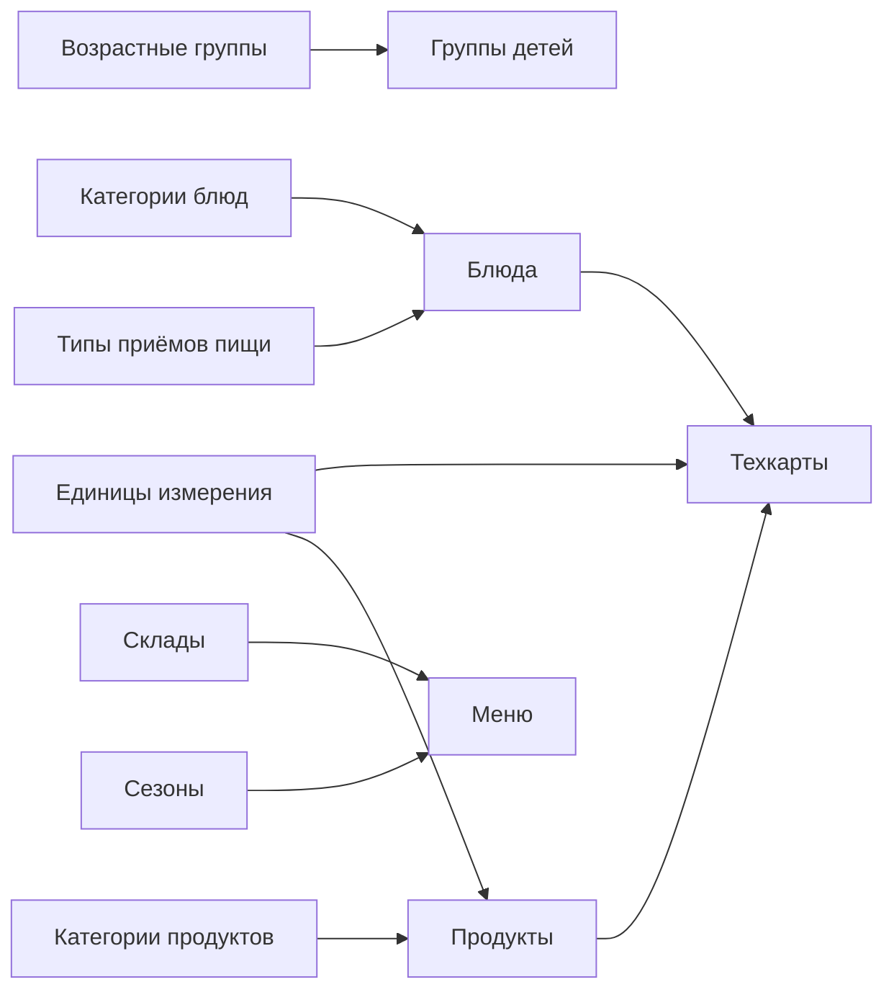

# ProfitFood — руководство пользователя и сценарий тестирования

## 1. Что делает программа

Учёт питания детского сада: справочники → техкарты → меню на дату → посещаемость → меню-требование на выдачу продуктов → складские документы и остатки.

## 2. Где лежат данные

| Что | Где |
|---|---|
| База данных | `%LOCALAPPDATA%/ProfitFood/profitfood.db` (путь переопределяется в `appsettings.json`, секция `Database`) |
| Журнал | `%LOCALAPPDATA%/ProfitFood/logs/app-ГГГГММДД.log`, хранятся 14 дней |
| Файл настроек | `appsettings.json` рядом с `ProfitFood.exe` |

> **Важно перед тестированием.** Не удаляйте файл базы: программа при старте не создаёт и не обновляет схему, и пустая база приведёт к ошибкам при первом же запросе. Перед экспериментами сделайте копию файла.

## 3. Порядок первичного заполнения

Справочники связаны внешними ключами, поэтому порядок не произвольный: продукт не сохранится без категории и базовой единицы, блюдо — без категории и приёма пищи, техкарта — без блюда.

### Экраны заполнения (раздел «Справочники»)

Слева — список из десяти пунктов, справа — карточка записи. Для всех справочников порядок один: выбрать запись в таблице, заполнить карточку, нажать «Сохранить».

| № | Справочник | Что заполнить обязательно | Примечание |
|---|---|---|---|
| 1 | Единицы измерения | Наименование, краткое, тип, коэффициент, флажок «базовая» | Коэффициент означает, сколько базовых единиц в одной этой: килограмм = 1, грамм = 0,001 |
| 2 | Категории продуктов | Наименование | Группировка продуктов |
| 3 | Возрастные группы | Наименование, возраст «от» и «до» в месяцах | «До» не может быть меньше «от» |
| 4 | Группы детей | Наименование, возрастная группа, плановая численность | Численность участвует в расчёте требования |
| 5 | Типы приёмов пищи | Наименование, код, порядок | Порядок задаёт сортировку в меню |
| 6 | Категории блюд | Наименование, порядок | — |
| 7 | Блюда | Наименование, код, категория, приём пищи | Нужны для техкарт |
| 8 | Сезоны | Наименование, месяцы «от» и «до» в диапазоне 1–12 | Привязываются к меню |
| 9 | Склады | Наименование, код | Первый по алфавиту используется в требованиях |
| 10 | Продукты | Наименование, категория, базовая единица, минимальный остаток | Складская единица и артикул — по желанию |

## 4. Рабочий цикл

### Шаг 1. Техкарта — раздел «Техкарты»

Заполняется номер карты, блюдо, версия (дата начала, выход и его единица, утверждение), затем ингредиенты и выход по возрастам.

- Ингредиент: продукт, единица, брутто, нетто, процент потерь. Нетто — норма на стандартный выход версии.
- Выход по возрастам задаёт порцию для каждой возрастной группы. Если не заполнять, порция считается одинаковой для всех.
- Две строки для одной возрастной группы сохранить нельзя.
- Правки применяются к актуальной версии карты — с максимальной датой начала действия.

### Шаг 2. Меню — раздел «Меню»

1. Нажать «Добавить», выбрать дату и сезон, при желании примечание, нажать «Сохранить». Номер меню не присваивается: документ опознаётся по дате.
2. Ниже карточки находится блок «Посещаемость»: по каждой группе видны план и факт. Факт редактируется, затем нажать «Сохранить посещаемость».

Факт не может быть больше плана и меньше нуля.

### Шаг 3. Требование — раздел «Требования»

В шапке выбрать меню из выпадающего списка и нажать «Рассчитать по меню». Программа создаёт черновик `МТ-ГГГГ-NNNN` со строками «продукт, единица, количество».

$$
Q_{\text{продукт}} = \sum_{\text{возрастные группы}} N_{\text{детей}} \cdot \sum_{\text{ингредиенты}} \text{Нетто} \cdot \frac{\text{Выход}_{\text{возраст}}}{\text{Выход}_{\text{версии}}}
$$

Количество детей берётся так: сначала факт посещаемости, если нули — план, если записей вовсе нет — плановая численность групп. Если и её нет, расчёт останавливается с сообщением, а не выдаёт нули.

### Шаг 4. Склад и документы

Раздел **«Склад»** показывает остатки по продуктам и складам. Колонка «Дефицит» отмечает позиции ниже минимального остатка; кнопка «Добавить» позволяет внести остаток вручную.

Раздел **«Документы»**: четыре типа, номер присваивается автоматически.

| Тип | Префикс | Что делает с остатком |
|---|---|---|
| Приход | `ПР` | прибавляет |
| Выдача | `ВД` | вычитает, минус запрещён |
| Списание | `СП` | вычитает, минус запрещён |
| Инвентаризация | `ИНВ` | устанавливает фактическое количество |

Порядок работы: «Новый документ», затем тип, склад и дата, затем добавить строки (продукт, единица, количество, цена), нажать «Сохранить», затем «Провести».

Проведение и отмена проведения выполняются в одной транзакции: если хотя бы одна строка выдачи не покрыта остатком, откатывается весь документ. Отменить проведение инвентаризации нельзя, потому что она затирает прежнее количество без следа.

### Шаг 5. Главная панель

Показывает дату, статус меню на сегодня, количество блюд в нём, число детей (плановая численность), число продуктов, позиции меню на сегодня, позиции ниже минимума, последние пять документов и предупреждения.

Предупреждения формируются по фактам: «На сегодня меню не создано», «Ниже минимального остатка: N», «Не проведено документов за сегодня: N».

## 5. Чек-лист тестирования

| № | Действие | Ожидаемый результат |
|---|---|---|
| 1 | Запустить программу | Открывается главная, боковое меню из 7 разделов, вкладки открываются и закрываются |
| 2 | Заполнить единицы: «Килограмм» (коэффициент 1, базовая) и «Грамм» (коэффициент 0,001) | Обе записи в таблице, «Грамм» не помечен как базовая |
| 3 | Создать продукт без категории | Сохранение отклонено с сообщением о категории |
| 4 | Заполнить продукт «Молоко»: категория, базовая единица «Килограмм», минимальный остаток 1 | Строка появилась в таблице |
| 5 | Создать возрастные группы «Младшая» (12–36) и «Старшая» (36–84) | Обе в таблице; попытка указать «до» меньше «от» отклоняется |
| 6 | Создать группы детей: 10 младших, 20 старших | Численность отображается |
| 7 | Техкарта: блюдо «Каша», версия с выходом 200 г, ингредиент «Молоко» нетто 0,2 кг | Ингредиент в таблице, количество пересчитано |
| 8 | Добавить выходы: младшая 100 г, старшая 150 г | Обе строки видны; повторное добавление той же группы отклоняется |
| 9 | Меню на сегодня и посещаемость: факт 8 и 18 | План 10 и 20, факт сохранён |
| 10 | Раздел «Требования», выбрать меню, нажать «Рассчитать по меню» | Черновик `МТ-…` с одной строкой «Молоко» = **3,5 кг** (8×0,2×½ + 18×0,2×¾) |
| 11 | Приход на 5 кг молока, нажать «Провести» | Остаток 5 кг, статус «Проведён» |
| 12 | Выдача на 10 кг, нажать «Провести» | Ошибка «Недостаточно продукта», остаток остался 5 кг, документ в черновике |
| 13 | Инвентаризация на 3 кг, провести, затем «Отменить проведение» | Остаток стал 3 кг; отмена отклонена с объяснением |
| 14 | Главная панель | Статус «Черновик», 30 детей, позиция меню, предупреждения о дефиците и непроведённых документах |

## 6. Что пока не работает — не считать ошибкой

| Ограничение | Следствие |
|---|---|
| Печати нет | Форму 299 распечатать нельзя, статус `Printed` не выставляется |
| Меню-требование не создаёт складской документ | Выдачу на кухню оформляют вручную в разделе «Документы» |
| Цена и сумма в требовании равны нулю | Стоимость кухни не считается |
| Схема базы не обновляется при старте | После обновления программы старую базу нужно мигрировать отдельно |
| Потери (`LossPercent`) не участвуют в расчёте | Расход считается по нетто |
| Техкарта правится только в актуальной версии | Истории версий в интерфейсе нет |
| Единицы выхода по возрастам не проверяются на согласованность | Если задать граммы и килограммы вперемешку, коэффициент будет неверным |

## 7. Если что-то пошло не так

- **Расчёт требования падает** — почти всегда не заполнены ингредиенты у блюда в меню или нет ни одной группы детей с численностью.
- **Пустой экран раздела** — проверьте журнал в `%LOCALAPPDATA%/ProfitFood/logs`: при ошибке загрузки внизу экрана будет сообщение.
- **Данные не появились после сохранения** — нажмите «Обновить»: списки перечитываются из базы, а не из памяти.
